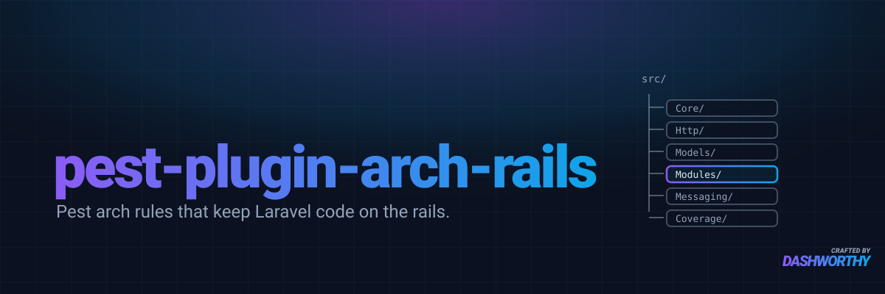

# pest-plugin-arch-rails

Architecture rules for Laravel, written as Pest expectations. They plug straight
into `pest-plugin-arch`: no DSL, no selector grammar, no reporting layer of its
own. Every verb composes with the `arch()` chains you already write.

## Install

```bash
composer require --dev dashworthy/pest-plugin-arch-rails
```

The expectations register themselves through Composer's `autoload.files`. There
is nothing to publish and no service provider.

## Areas

The package is organised by area. Each lives in its own directory under `src/`,
registers its own verbs, and has its own page covering usage, configuration and
edge cases:

- [Messaging](docs/messaging.md): queued jobs, notifications and mailables
- [Models](docs/models.md): Eloquent table names and mass assignment
- [Http](docs/http.md): form requests, controllers, API resources and permissions
- [Modules](docs/modules.md): directory and naming rules for modular (DDD) code
- [Coverage](docs/coverage.md): every class has a test at the mirrored path

## Verbs

| Area | Verb | Passes when |
|---|---|---|
| [Messaging](docs/messaging.md) | `toBeQueued()` | the class implements `ShouldQueue` (or `ShouldQueueAfterCommit`, which extends it) |
| [Messaging](docs/messaging.md) | `toBeQueuedAfterCommit()` | the class implements `ShouldQueueAfterCommit` specifically |
| [Messaging](docs/messaging.md) | `toBeSync()` | the class implements neither: dispatch is deliberately synchronous |
| [Messaging](docs/messaging.md) | `toDeclareNotificationChannels()` | `via()` exists and returns a non-empty channel list |
| [Messaging](docs/messaging.md) | `toUseMarkdownMailTemplates()` | `content()` names a markdown template rather than a plain view |
| [Models](docs/models.md) | `toMatchTableName()` | an Eloquent model resolves the table its class name implies |
| [Models](docs/models.md) | `toGuardMassAssignment()` | a model declares `$fillable` or `$guarded`, or relies on the fully guarded default |
| [Http](docs/http.md) | `toAuthorizeWithGate($expectedAbility)` | what `authorize()` returns depends on a gate check, of the ability `$expectedAbility` derives from the class name when given |
| [Http](docs/http.md) | `toUseFormRequests()` | every public controller action takes a form request (or no request) and does not validate inline |
| [Http](docs/http.md) | `toReturnJsonResources()` | every public controller action declares a `JsonResource` subclass as its return type |
| [Http](docs/http.md) | `toMatchGateAbilities($directories, $alsoChecked)` | (on a list of permission names) every permission is checked somewhere (a Gate call, `->can()`, `can:` middleware or `@can`), and every checked ability is a permission |
| [Modules](docs/modules.md) | `toUseApprovedDirectories($directories, $beneath)` | every class in a module sits in an approved directory, and is the type that directory names |
| [Modules](docs/modules.md) | `toUseDirectorySuffixes($suffixes, $beneath)` | a class in a module's directory, however deeply nested, ends in the suffix that directory calls for |
| [Coverage](docs/coverage.md) | `toHaveTests($map, $suffix, $skip, $exempt)` | every class under a mapped source directory has a test file at the mirrored position |

`toMatchGateAbilities()` is the odd one out: it is an ordinary expectation, not an
arch one. Its subject is the list of permission names rather than a selection of
classes, so it reports every mismatch in one run.

`src/Core` holds no verbs. It is the shared base the areas build on: `Rule`
turns an inspector (a class that returns a failure message, or null) into an arch
expectation whose message can name the offending value, and `LineFinder` points
the failure at a useful line.

## Example

Give each of this package's verbs its own `arch()` call. Pest applies a
selector such as `->classes()->extending(...)` only to the first verb in a
chain, so a second verb would run against every class in the namespace.

```php
use Illuminate\Database\Eloquent\Model;

arch('every model guards mass assignment')
    ->expect('App')
    ->classes()
    ->extending(Model::class)
    ->toGuardMassAssignment();

arch('every model matches its table name')
    ->expect('App')
    ->classes()
    ->extending(Model::class)
    ->toMatchTableName();
```

## What you are accepting

These are arch expectations, so they inherit arch's behaviour:

- **One violation per run.** A rule failing across forty classes reports the
  first and stops.
- **`@pest-arch-ignore-line` suppresses any of them.** Police its use with an
  arch test of your own if that matters to you:

  ```php
  arch('no source file suppresses an architecture rule')
      ->expect('App')
      ->not->toUse('@pest-arch-ignore-line');
  ```
- **An empty layer passes.** A typo'd namespace turns a rule green. Assert the
  layer is non-empty separately if you need that guard.

## Editor and agent support

The package ships a Laravel Boost skill, `enforcing-arch-rails`, and a
guideline. Boost discovers them at `resources/boost/skills/` and
`resources/boost/guidelines/` for every installed package, so a consuming
project picks them up by running:

```bash
php artisan boost:update
```

The skill explains which verb covers which case and how to scope or exempt one;
the guideline is the short form injected into the project's AI guidelines.

## Licence

MIT.
